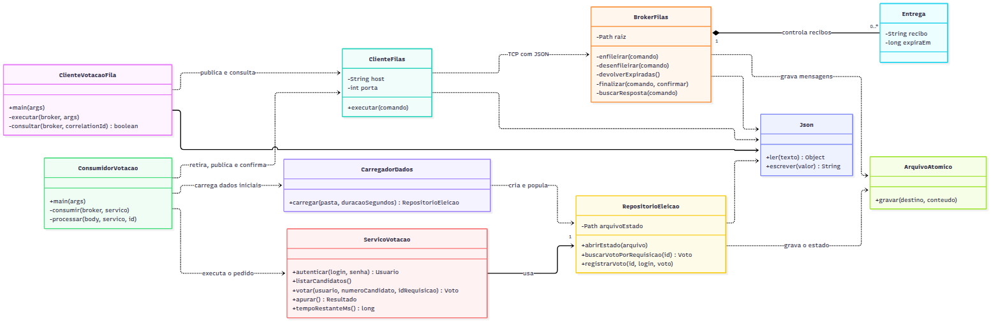
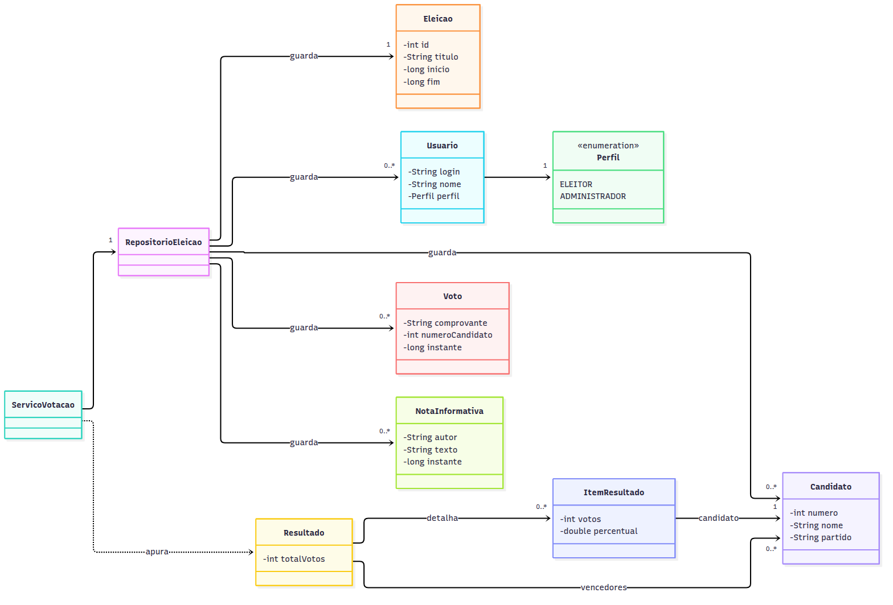
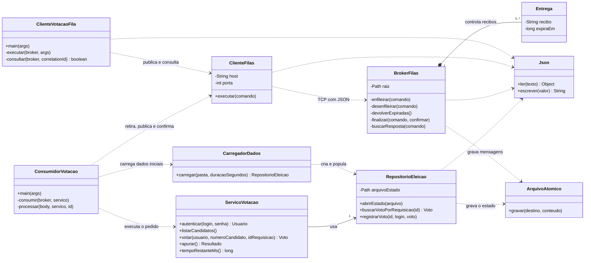
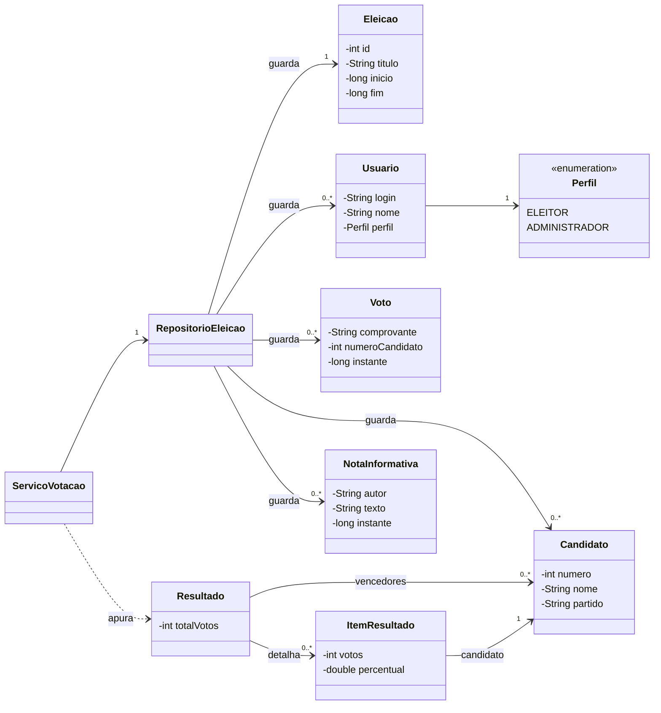

# Diagrama de classes — Trabalho 4

## Imagens renderizadas pelo Mermaid

### Fluxo de votação por filas

### Modelo da eleição

Ver código Mermaid

## Fluxo de votação por filas

A ligação **TCP com JSON** representa comunicação entre processos. O cliente e o consumidor usam instâncias de `ClienteFilas` para se conectar ao broker. `Entrega` é uma classe interna do broker. Ela guarda o recibo e o prazo de confirmação de uma retirada.

## Modelo da eleição

O voto referencia o candidato pelo campo `numeroCandidato`. O repositório também mantém o controle de quem já votou. Os diagramas mostram os atributos e métodos relevantes ao fluxo de votação e à apuração.

